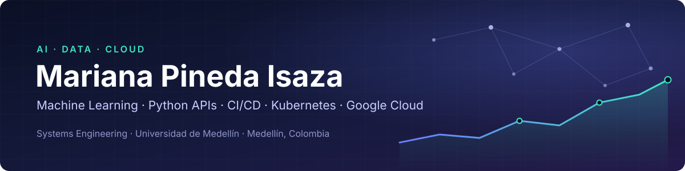
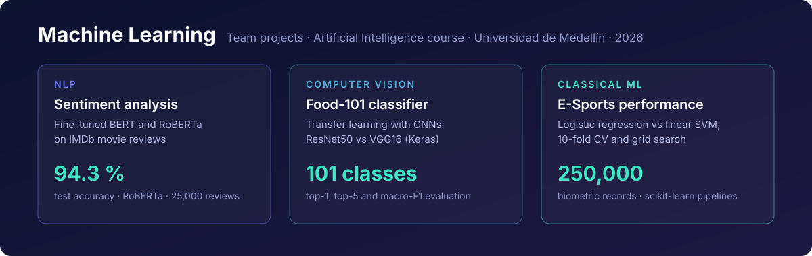
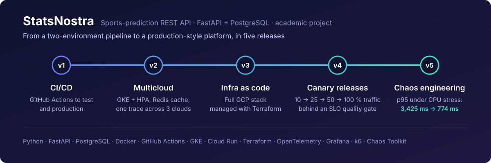

### About me

Systems Engineering at Universidad de Medellín, Colombia: all coursework completed (Nov 2026), degree conferral March 2027.

I work where machine learning meets software delivery. In my AI coursework I fine-tuned transformer models for NLP, trained CNNs with transfer learning and built classical ML pipelines with cross-validation. On the engineering side, I build Python APIs and take them to the cloud with CI/CD, Kubernetes, infrastructure as code and observability. My goal is to bring both together: putting models into production.

### Tech I've used in projects

**Machine learning** 

**Backend & data** 

**Cloud, DevOps & observability** 

### Machine learning projects

- [**Sentiment analysis on IMDb**](https://github.com/MarianaPineda0/sentiment-analisis-imdb): fine-tuning BERT and RoBERTa with Hugging Face Transformers and PyTorch; RoBERTa reached 94.28 % accuracy and 94.34 F1 on 25,000 test reviews.
- [**Food-101 image classification**](https://github.com/MarianaPineda0/Food101-Artificial-Vision): transfer learning with ResNet50 and VGG16 in TensorFlow/Keras, hyperparameter search and top-1 / top-5 / macro-F1 evaluation across 101 classes.
- [**E-Sports biometrics & performance**](https://github.com/MarianaPineda0/E-Sports-ML): logistic regression vs linear SVM on 250,000 records with scikit-learn pipelines, 10-fold cross-validation and grid search.

### Cloud & DevOps project

In the canary release (v4), the new version is compared with the stable one in the same time window and is promoted only if error rate, p95/p99 latency, CPU, memory and a business metric stay within thresholds versioned with the code; otherwise traffic returns to stable automatically. The cloud infrastructure was decommissioned when the course ended; the code, Terraform and pipeline history remain in the [repository](https://github.com/MarianaPineda0/StatsNostra).
